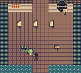
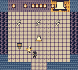

# PocketHoller: After Sundown

A complete native Game Boy Color adventure starring **Marty and Roam**: 24 playable rooms, 12 puzzles, Lantern Moth, Mossback Turtle and Thunderbird, four safe camps, six optional journal pages, and a warm dawn reunion.


## Play

Download [the full game and continuous video](https://github.com/martinbowling/pocket-holler/releases/tag/v1.0.0), or open [the included cartridge](native/dist/PocketHoller-full.gbc) in a Game Boy Color emulator. Press **Start** or **A** at the animated title, then choose **New Game**. This cartridge requires color hardware. The private repository and release are available to the owner and authorized collaborators.

| Input | Action |
| --- | --- |
| D-pad | Walk; move menu selection |
| A | Talk, inspect, advance dialogue, confirm |
| B | Use the selected companion ability; cancel menus |
| Start | Journal, Settings, Return to Camp, Quit and Resume |
| Select | Show the next objective |

Browser keys are arrows, **Z**, **X**, **Enter** and **P** respectively. Swap Actions exchanges A/B in exploration; menus retain A confirmation and B cancellation. Select objective pages accept any button; multiple pages can require multiple presses.

Roam wears green and has curly hair; Marty wears orange and glasses. Choose **Character** at a safe camp to switch. Both share progress. Moth reveals ray marks, Turtle steadies wave stones and Thunderbird sparks zigzag fixtures. Face the marked actor from an adjacent tile and press the ability button. Camp menus offer recruited companions or Travel alone.

Save explicitly at the porch, creek camp, ridge camp or root threshold, then confirm. Return to Camp preserves session progress but does not save. Continue restores the character, companion, puzzles, journal and comfort settings at a safe camp; unfinished puzzle attempts reset. Keep the emulator battery file paired with its exact cartridge. Historical opening saves are a different epoch and are not portable to this release.

Music and Effects have separate switches, Quiet preset silences both, Reduced Scares keeps essential clues in ordinary text, and three text speeds are available. There is no combat, death, companion harm, timer, authored flashing or screen shake.





## Edit and build

Open [native/project.gbsproj](native/project.gbsproj) in GB Studio with its adjacent `project/`, `assets/` and `plugins/` folders. The editable native resources are authoritative. This release was built with the official **GB Studio CLI 4.3.2**; the descriptor uses schema 4.2.0/release 10.

From the repository root:

```sh
sh native/tools/build.sh
```

For another installation:

```sh
POCKETHOLLER_NODE=node \
POCKETHOLLER_CLI=/absolute/path/to/gb-studio-cli.js \
sh native/tools/build.sh
```

The wrapper writes `native/dist/PocketHoller-full.gbc`. Preserve the included verified ROM and matching debug directory before rebuilding. Receipt-paired emulator tests require new debug artifacts and a matching build receipt from ModRetro `rom_build`; the wrapper alone does not generate those. See [build notes](native/docs/build.md).

The local working project lives in `/Users/martinbowling/Projects/pocket-holler/native`. Completed changes are synchronized into `/Users/martinbowling/Projects/pocket-holler/src/native`, with Git operations performed from `src/`. A normal clone uses the repository root directly.

## Verification

```sh
python3 native/tests/check_project.py
python3 -m venv .venv
. .venv/bin/activate
python -m pip install -r native/requirements-dev.txt
python native/tests/full_game.py
python native/tests/full_playthrough.py
```

The full regression used 175,653 genuine controller-input frames over 15 boots: all 24 rooms, all 12 puzzles, 53 directed connections, six bell-lamp orders, all optional pages, a zero-journal ending, both players, companion choices, four camp cold loads, wrong/reset/repeat actions and swapped exploration controls. No memory writes, save-state injection or initial RAM fixture sets progression. The continuous video replays a separate 107,468-frame single-boot journey with normal native game audio.

The clean copied source compiles successfully. Every cartridge byte except the generated project save signature and global checksum matches the tested ROM; this is not a byte-identical build or proof of cross-build save compatibility. Exact reports and limits are in [QA](native/docs/qa-report.md). Physical Chromatic testing, human audio listening and fresh-player pacing remain pending. [Known issues](native/docs/known-issues.md) documents the remaining cosmetic simplifications.

Verified full ROM SHA-256:

```text
de3ed696c6a80b5007ccc825693fabb781a661d30814fa6694864c467453b5d2
```

## Source layout

| Path | Contents |
| --- | --- |
| `native/project.gbsproj`, `native/project/` | Editable native game and scripts |
| `native/assets/`, `native/art/source/` | Runtime art/music and editable recipes |
| `native/docs/` | Design, rooms, variables, controls, saves, accessibility and QA |
| `native/tests/`, `native/tools/` | Controller-driven verification and build helpers |
| `native/dist/` | Full cartridge, historical opening and paired debug artifacts |
| `native/evidence/` | Exact build and verification receipts |
| `docs/images/` | Real emulator screenshots |
| `release-work/` | Historical proposals; integrated implementation is under `native/` |

Local recordings, RAM, temporary builds and the owner-supplied concept sheet are excluded from Git. The release includes the full video and source ZIP. Local video is beside `src/`, in `../videos/PocketHoller-full-playthrough.mp4`; retained frame/input evidence is in `../native/evidence/`. Opening artifacts remain separately preserved. Do not replay historical actor-creation batches over the current project.

## Licensing and provenance

An overall public license for new PocketHoller code, art, narrative and audio has not been chosen. Upstream MIT notices in `native/licenses/` and `native/LICENSE` do not grant a blanket license to new game content. See [THIRD_PARTY.md](native/THIRD_PARTY.md), [credits](native/docs/credits.md) and [asset inventory](native/docs/asset-inventory.csv). Family photographs and the reference sheet are not included.
