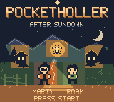
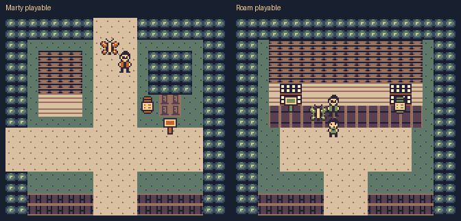

# PocketHoller: After Sundown

A native Game Boy Color adventure starring **Marty and Roam**, set in a mountain town with dependable creatures, lantern puzzles, and a little unease after dark.



This repository contains the editable GB Studio source, native pixel art and its editable recipes, development tools, automated checks, and one verified opening-review ROM.

## Play the opening

Download [`native/dist/PocketHoller-opening.gbc`](native/dist/PocketHoller-opening.gbc) and open it in a Game Boy Color emulator. This cartridge requires color hardware. Press **Start** or **A** on the title, then choose **New Game**. **B** returns from the title menu to the artwork.

The opening includes six playable rooms, both characters, Lantern Moth, two puzzles, an optional journal page, the first repaired light, dusk, and a porch save checkpoint.

| Input | Action |
| --- | --- |
| D-pad | Walk and move menu selection |
| A | Talk, inspect, advance dialogue, confirm |
| B | Lantern Moth Reveal on a faced marked target; cancel menus |
| Start | Open Journal, Settings, Return to Camp, Quit, or Resume |
| Select | Show the current objective and companion |

At the porch, talk to the other character and choose **Character** to switch between **Roam** and **Marty**. Roam wears green; Marty wears orange and glasses. Both share puzzle progress and companion abilities. Save/Continue retains the selected character.

Save at the porch and confirm. **Return to Camp** keeps current progress but does not save. There is one save slot. Preserve the emulator's battery-save file alongside the cartridge. See [controls and saves](native/README.md) for details.



## Edit and build

In the local workspace, this Git repository lives at `/Users/martinbowling/Projects/pocket-holler/src`. Run the commands below from that folder. A normal clone uses the same repository layout directly at its clone root.

Open [`native/project.gbsproj`](native/project.gbsproj) in GB Studio. The distributed project stores scenes, actors, triggers, palettes, and variables in `native/project/`; keep that folder and `native/assets/` with the descriptor.

The opening was built with the official **GB Studio CLI 4.3.2**. The descriptor uses schema 4.2.0/release 10. The included wrapper defaults to the verified macOS ModRetro toolchain installation:

```sh
sh native/tools/build.sh
```

For another installation, provide your Node executable and official GB Studio CLI path:

```sh
POCKETHOLLER_NODE=node \
POCKETHOLLER_CLI=/absolute/path/to/gb-studio-cli.js \
sh native/tools/build.sh
```

The ROM is written to `native/dist/PocketHoller-opening.gbc`. Building replaces the included review cartridge; preserve it first if you need its paired save fixtures. [Build notes](native/docs/build.md) document the verified environment and ModRetro source-debug build workflow.

A ModRetro browser preview uses the same project. Its keyboard controls are arrows, **Z** for A, **X** for B, **Enter** for Start, and **P** for Select.

## Verify changes

The source check uses only Python's standard library:

```sh
python3 native/tests/check_project.py
```

For emulator checks, install the tested development dependencies in a virtual environment:

```sh
python3 -m venv .venv
. .venv/bin/activate
python -m pip install -r native/requirements-dev.txt
python native/tests/intro_screen.py
python native/tests/persistent_save.py
python native/tests/character_switch.py
python native/tests/exit_regression.py
```

The included cartridge, debug symbols, build receipt, and QA-only battery fixture are paired. These tests use ordinary controller inputs and private temporary emulator files. They check title motion/menus, both puzzles, Save/Continue, comfort settings, character switching, and room transitions. A rebuilt cartridge needs refreshed matching build/debug outputs and a newly generated save fixture; old fixtures are not portable between builds. Read [fixture notes](native/tests/fixtures/README.md) before updating them.

## Source layout

| Path | Contents |
| --- | --- |
| `native/project.gbsproj` | Editable project entry point |
| `native/project/` | Native gameplay resources and scripts |
| `native/assets/` | Backgrounds, sprites, font, UI, and asset metadata |
| `native/art/source/` | Editable native pixel and character cell recipes |
| `native/docs/` | Design, room/variable registers, accessibility, saves, QA, known issues |
| `native/tests/` | Source and emulator checks with portable QA fixtures |
| `native/tools/` | Build, development, review-package, and video helpers |
| `native/dist/` | Verified review cartridge and matching debug symbols |
| `docs/images/` | Actual emulator screenshots used in this README |

The native resources are authoritative. Historical authoring batches are development records; replaying them can duplicate actors. Preserve resource IDs and use the guidelines in [CONTRIBUTING.md](CONTRIBUTING.md).

Large recordings, temporary builds, emulator sessions, review archives, and the original owner-supplied concept sheet remain local and are excluded from Git. In the local workspace, retained recordings are alongside `src/` in `../native/evidence/`; the continuous **4:43** emulator playthrough with game audio is at `../videos/PocketHoller-opening-playthrough.mp4`. The video and review-package helpers resolve these sibling folders when the repository lives in `src/`. A fresh clone needs the retained recordings separately to run those helpers.

## Current status

The opening is implemented and exercised in the emulator. The title has copper lettering, moonlit ridges, lit cabins, Marty and Roam, and gently breathing Lantern Moth light. The included ROM's SHA-256 is:

```text
511e690076d4a500a21c7f65d238a4f67b807d5a53d2f40a12115c7336b2d06a
```

Opening acceptance still needs owner review and fresh-player pacing tests. Physical Chromatic testing is pending. Eighteen further rooms, Turtle, Thunderbird, later puzzles, the finale, production music, and the dawn epilogue remain planned. [Known issues](native/docs/known-issues.md) covers current input and story limitations; [the QA report](native/docs/qa-report.md) distinguishes tested behavior from pending work. Full recording evidence is retained in the local review package.

## Licensing and provenance

An overall public license for new PocketHoller code, art, narrative, and audio has not been chosen. Upstream GB Studio and ModRetro MIT notices are retained in `native/licenses/` and `native/LICENSE`; those notices do not license all new game content. See [THIRD_PARTY.md](native/THIRD_PARTY.md) and [the asset inventory](native/docs/asset-inventory.csv) for provenance and current review status.
